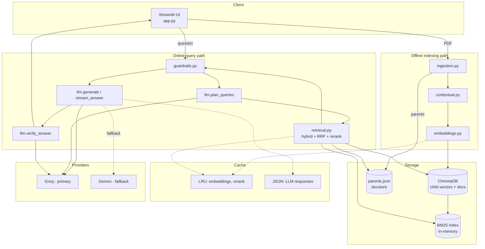
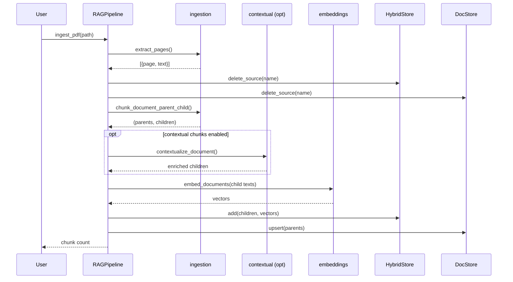
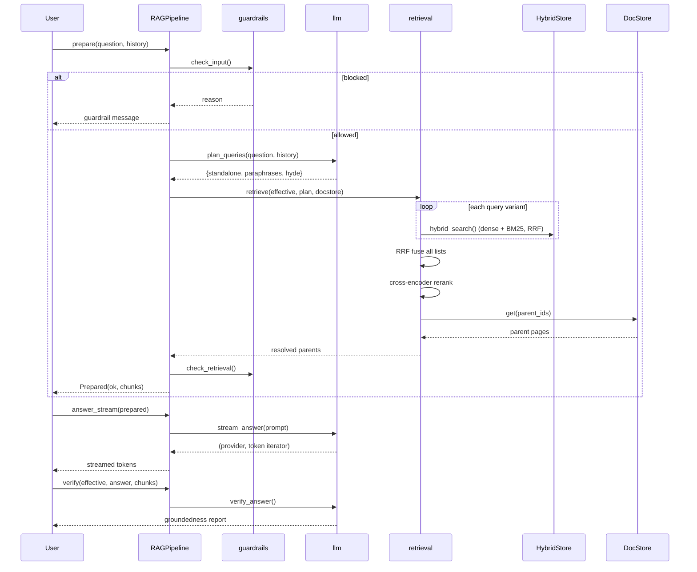
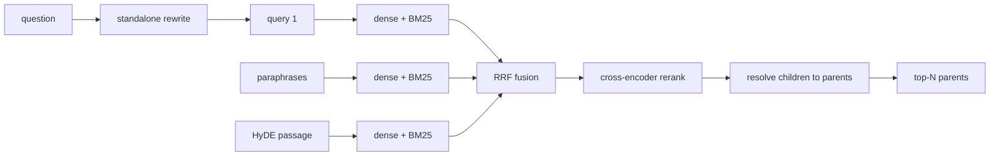
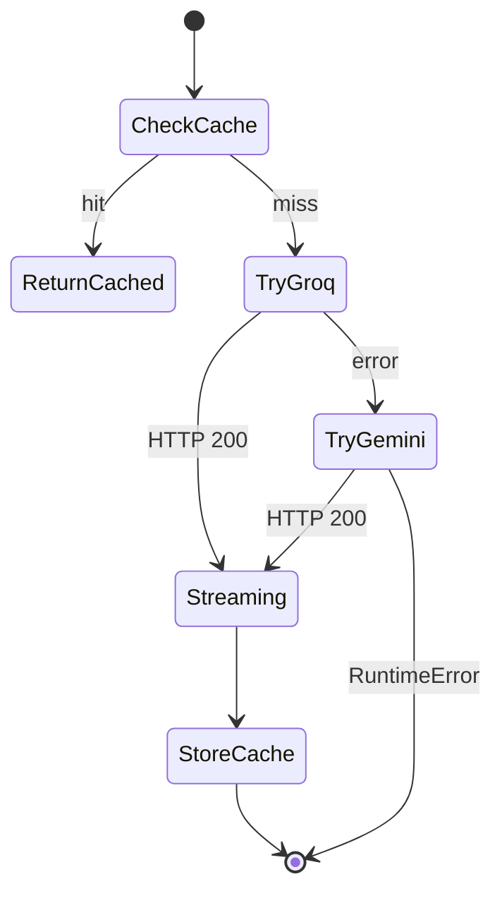
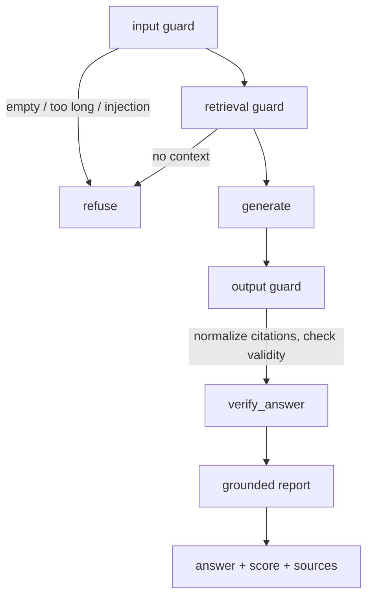

# DocuMind Architecture

A deep dive into how DocuMind ingests documents, retrieves evidence, and produces
grounded, cited answers.

---

## 1. Design philosophy

DocuMind is split into **two distinct paths**:

- an **offline indexing path** — runs once per document, may be slow, does the expensive work;
- an **online query path** — runs per question, must be fast, accurate and well-grounded.

Two principles drive the design:

1. **Do expensive work once.** Embedding, chunking and contextual enrichment happen at
   ingest time. The query path only reads precomputed structures.
2. **Defense in depth for grounding.** Retrieval quality is improved in successive layers
   (hybrid → fusion → rerank → parent expansion), and the generated answer is validated
   *after* the fact. The system is designed to say "I don't know" rather than hallucinate.

---

## 2. System overview



---

## 3. Offline path — indexing

### 3.1 Sequence



### 3.2 Chunking model

`chunk_document_parent_child` produces **two synchronized levels**:

| Level | Unit | Size | Stored in | Purpose |
|---|---|---|---|---|
| Parent | whole page | ~1 page | `parents.json` | full context for the LLM |
| Child | overlapping slice | ~350 chars | Chroma + BM25 | precise matching unit |

Each child carries `metadata.parent_id` pointing to its parent page. This decouples
**match granularity** from **context granularity** — the core of small-to-big retrieval.

### 3.3 Metadata schema

```json
// child
{
  "id": "report.pdf::p3::c2",
  "text": "...",
  "metadata": {
    "source": "report.pdf",
    "page": 3,
    "parent_id": "report.pdf::p3",
    "kind": "child",
    "chunk_index": 2
  }
}

// parent
{
  "id": "report.pdf::p3",
  "text": "<full page>",
  "metadata": { "source": "report.pdf", "page": 3, "kind": "parent" }
}
```

---

## 4. Online path — querying

### 4.1 Sequence



### 4.2 Retrieval pipeline



Step by step:

1. **Plan** (`llm.plan_queries`) — one call yields a standalone rewrite, N paraphrases
   and a HyDE passage.
2. **Hybrid search** — each variant queries Chroma (dense) and BM25 (sparse); those two
   lists are fused with RRF inside `HybridStore.hybrid_search`.
3. **Cross-variant RRF** — the per-variant lists are fused again in `retrieval._rrf_fuse`.
4. **Rerank** — a cross-encoder (`bge-reranker-base`) scores every fused candidate against
   the standalone query. It reads query+chunk jointly, far more accurate than vector cosine.
5. **Resolve** — `_resolve_parents` keeps the best-scoring child per parent, orders parents
   by that score, and loads the full page text from the docstore.

---

## 5. Providers & streaming

Groq is primary, Gemini is the fallback. Fallback is decided **before streaming begins**,
so an answer never breaks mid-stream.



- Groq: OpenAI-compatible `chat/completions` with `stream: true`.
- Gemini: `streamGenerateContent?alt=sse` with `thinkingConfig.thinkingBudget = 0`
  (Gemini 3.x is a thinking model; thinking is disabled for fast RAG answers).
- SSE is decoded as **forced UTF-8** because `requests` otherwise guesses latin-1 and
  corrupts multi-byte characters (e.g. full-width `【1】`).

---

## 6. Guardrails & verification



- **Input** — empty/oversized queries and prompt-injection patterns are rejected.
- **Retrieval** — if nothing relevant was found, answer "I don't know" honestly.
- **Output** — citation markers are normalized (`【1】` → `[1]`), validated against the
  chunk count, and refusals detected.
- **Verification** — a separate zero-temperature auditor LLM returns
  `{grounded, score, unsupported_claims, reason}`. Writer and checker are different calls,
  so drift is caught independently.

---

## 7. Caching

Content-addressed keys (SHA-256 of model + prompt + parameters) mean correct invalidation
for free — change a prompt or model and the affected entries simply miss.

| Cache | Backing | Keyed by | Lifetime |
|---|---|---|---|
| Embeddings | in-memory LRU | model + text | process |
| Rerank scores | in-memory LRU | model + query + candidate ids/texts | process |
| LLM responses | JSON on disk | model + system + prompt + params | persistent |

Measured effect: cold query ≈ 45 s, repeat query ≈ 0.03 s.

---

## 8. Module map

| Module | Responsibility |
|---|---|
| `src/config.py` | Load `.env`, define `Settings` and paths |
| `src/ingestion.py` | PDF extract, clean, single + parent/child chunking |
| `src/contextual.py` | Optional contextual-chunk enrichment |
| `src/embeddings.py` | Local bge embeddings with memoization |
| `src/vectorstore.py` | ChromaDB + BM25 hybrid store with RRF |
| `src/docstore.py` | JSON store for parent pages |
| `src/retrieval.py` | Multi-query retrieve, RRF, rerank, parent resolution |
| `src/guardrails.py` | Input/retrieval/output guards, citation normalization |
| `src/llm.py` | Groq + Gemini: generate, stream, plan, verify, cache |
| `src/cache.py` | LRU memory cache + JSON disk cache |
| `src/rag.py` | `RAGPipeline` orchestration façade |
| `app.py` | Streamlit UI |

---

## 9. Tradeoffs

| Aspect | Choice | Consequence |
|---|---|---|
| Latency vs quality | plan + generate + verify (3 calls) | ~45 s cold, mitigated by caching/toggles |
| Match vs context | parent/child | sharper ranking, richer prompt |
| Local vs API embeddings | local bge | no API dependency, heavy `torch` install |
| Grounding vs length | answers bounded by sources | cannot pad; length scales with corpus |
| Cross-encoder cost | applied to fused candidates only | accuracy without scoring the whole corpus |
